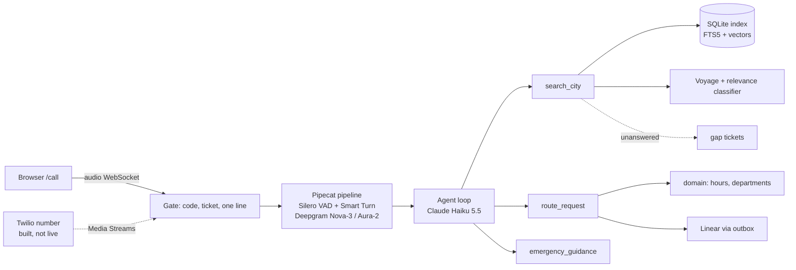

# vcity: write-up

A voice agent for the City of Corona, CA. It answers from the municipal code, the city website and city news, routes callers to the right department during office hours, and takes a request with a reference number when the office is closed. Try it at **https://vcity-dbykunzueq-uw.a.run.app/call** (the access code comes with the invitation). The design is in [`docs/spec.md`](docs/spec.md), and each PR description is its milestone's design note.

## Key decisions

- **One agent loop for text, voice and evals.** `Conversation` runs Claude Haiku 5.5 with adaptive thinking and three tools: `search_city`, `route_request` and `emergency_guidance`. The voice pipeline wraps it in a Pipecat processor instead of using Pipecat's LLM service, so the 43 scripted scenarios test the same prompt, tools and history handling that callers hear.
- **The model never decides whether an office is open.** Hours, holidays and "closing in 10 minutes" are a pure, unit-tested function in `domain/`. `route_request` calls it and returns either a transfer or a request. The domain imports nothing else (ports and adapters).
- **Answers come from the city's records, or the agent says it doesn't know.** Hybrid retrieval (SQLite FTS5 plus Voyage embeddings, fused by reciprocal rank) runs alongside a Haiku relevance classifier. Below a similarity of 0.53, a threshold picked by the retrieval eval, the agent abstains, and the question is clustered into a `gap` ticket in Linear.
- **Requests survive Linear being down.** Two 3-second attempts are made, then the request is queued in a SQLite outbox and retried every minute. The caller always gets a six-digit reference.
- **Barge-in keeps only what was heard.** Deepgram's speech socket sends no word timings, so they are estimated from each sentence's audio. When the caller interrupts, the history keeps only the words already played, marked as cut off. The agent then answers the interruption and repeats anything that still matters, such as a reference number. A single word like "okay" doesn't interrupt.
- **The public link costs money per call, so it is gated.** An access code buys a one-use ticket. The line takes one call at a time, a call is capped at 10 minutes, and 10 wrong codes lock the line for 60 s. One Cloud Run instance stays warm. Deploys authenticate with Workload Identity Federation, so no keys are stored.

## Course changes

| Planned | Delivered | Why |
|---|---|---|
| A Twilio phone line as the main surface | The browser call at `/call` | The task asks for a link to try. A phone line needs a public URL, and tunnelling a work laptop isn't acceptable. |
| Twilio trial number for routing | Built and tested, **not live** | The trial's Twilio-owned number blocks `<Stream>` and `<Dial><Number>`. Going live needs an upgraded account (about $20). |
| Render free hosting | Google Cloud Run | At Render's 0.1 CPU the pipeline never spoke, measured locally under the same limit. |
| ElevenLabs voice | Deepgram Aura-2 | The ElevenLabs free quota ran out, and Aura-2 bills the Deepgram credit the line already uses for transcription. |

## Components

## Real or mocked

| Ask | Real | Mocked or reduced |
|---|---|---|
| 1. Code and website | Hybrid retrieval with section citations, abstention gate | A manual snapshot of the code (American Legal blocks scripts) |
| 2. Current events | City news and events, with dates spoken | Crawled on a manual trigger, not searched live |
| 3. Tickets | Linear, with references, outbox and gap backlog | An in-memory sink for evals |
| 4. Routing | Department choice, hours decision, transfer | The browser shows the transfer on screen. The phone transfer is built but not live |
| 5. Hours | Pure function: Fridays, holidays, closing soon, DST | Nothing |
| 6. Evals | Four layers, gating deploys | Nothing |

## What isn't working

- **Turn-end latency in production.** Smart Turn often judges finished speech unfinished and waits out a silence fallback. At its default 3 s, the median from the caller going quiet to the first audio was 4.55 s over 7 replies. With the fallback at 1.5 s, it is 2.76 s over 4 replies (1.39–4.60 s), and 2 of the 4 still waited the full 1.5 s. A caller who pauses longer than 1.5 s mid-sentence is answered early.
- **No live phone line**, for the trial limits above.
- **Memory grows about 30 MB per call** in native code while the Python heap stays flat. Rather than chasing it, the server restarts itself when it is idle and above 1.4 GB.
- **A patched browser library.** `@pipecat-ai/websocket-transport` mutes the bot for the rest of a call after the first barge-in. The page clears the player's interrupted-track marks after each interrupt, which relies on a private field.
- **Retrieval edges.** The "State of the City" article scores 0.51, just under the gate, so the agent abstains (a marked known issue). The events search returns the top 5 upcoming events, so "this weekend" can miss one.
- **Small gaps:** the code lockout is global rather than per IP; the outbox lives on the container's in-memory disk; caller-text scrubbing in gap tickets misses names and addresses.

## What we'd build next

- A paid Twilio number, putting the built phone path live with real transfers.
- A fallback timeout tuned from measured turn data, and per-stage latency percentiles on a dashboard.
- Per-IP lockout, a durable outbox (Cloud SQL or a queue), and a date-window contract for events.
- Spanish, which the city site already publishes.

## Effort and results

- **Time:** about 12 hours.
- **Latency**, from the caller going quiet to the first audio: 1.28–1.85 s in the local audio smoke, median 2.76 s in production (4 replies). Production stages: transcription 0.09–0.14 s, LLM 0.88–2.57 s, speech synthesis 0.13 s, and turn detection under 0.1 s when Smart Turn ends the turn, 1.5 s on the fallback.
- **Unit tests:** 487 pass.
- **Retrieval** (CI): hit@3 0.94, MRR 0.86.
- **Scenarios** (CI, 43 scripted calls × 3 runs): 42 pass every run, plus 1 known issue. The Sonnet judge's mean scores out of 5 are 4.84 for correct, 4.79 grounded, 4.93 dated and 4.67 speakable. All 5 simulated callers reached their goals. A full run costs about $0.05.
